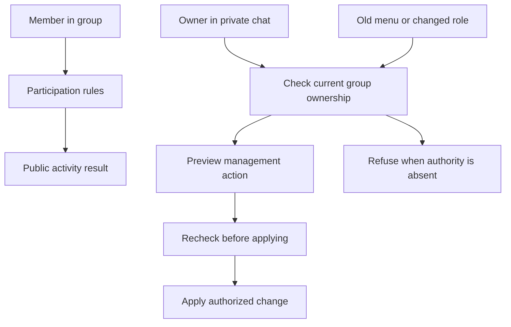
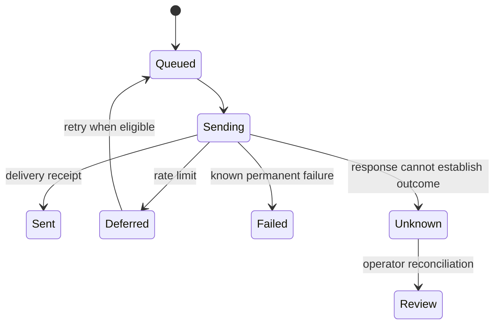

# Roles, delivery, and handoff

Conceptual diagrams explain selected decisions. They omit production identifiers, configuration, database schema, and the full service architecture.

## Interaction boundaries

A person's role can change after opening a menu. Checking only when the menu opens leaves an authorization gap. Management requires a current owner check at the relevant action boundary.

## Delivery outcomes

These state names are explanatory, not a production schema. Unknown delivery is deliberately visible. It is not automatically treated as failed and resent.

## Tradeoffs

| Decision | Reason | Cost or boundary |
| --- | --- | --- |
| Group participation, private owner controls | Keeps the member task close to the conversation and sensitive settings out of it. | The owner needs a clear path from the group to private management. |
| Recheck current ownership | Removes authority from stale menus after a role change. | Permission lookup failures need a recoverable refusal. |
| Persistent outbox | Preserves delivery intent and the distinction between queued and sent. | Uncertain outcomes need an explicit operator workflow. |
| Role and provenance checks in moderation | Avoids trusting display names and copied UI. | Available Telegram events and bot permissions limit coverage. |
| Separate platform and application ownership | Prevents a nominal transfer from leaving the wrong person in control. | A recipient must reconcile both layers before startup. |

## Handoff sequence

Stop the source runtime. Preserve the database and encryption material through private channels. Restore into a clean recipient environment. Reconcile platform and application authority. Start one runtime and exercise owner plus ordinary-member paths.

This sequence explains the engineering responsibility. Operational commands, secrets, original package contents, and customer infrastructure are not published.
